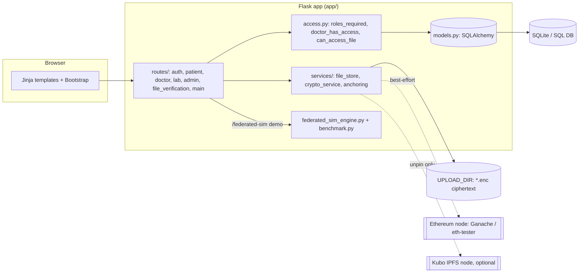

# Architecture

Research prototype; see [`SECURITY_AND_PRIVACY.md`](SECURITY_AND_PRIVACY.md) for
the trust model and limits. Everything below reflects the code in this repository.

## 1. Components

| Layer | Files | Notes |
|---|---|---|
| Web app | `app/__init__.py`, `app/routes/*`, `app/templates/*`, `app/static/js/main.js` | Application factory `create_app()`; CSRF, security headers and error handlers registered there |
| Authorisation | `app/access.py` | Central `roles_required`, ownership/treatment checks, file access rules |
| Config | `app/config.py` | Fail-closed secrets; `EHR_DEV_MODE` explicit opt-in |
| Data model | `app/models.py`, `db_migrations/versions/0001_baseline_schema.py` | 13 tables incl. `StoredFile`, `Consent`, `ErasureLog`, `VerificationLog` |
| Encryption | `app/services/crypto_service.py`, `file_store.py` | AES-256-GCM envelope encryption; HMAC anchor digest |
| Chain | `app/services/blockchain_service.py`, `anchoring.py`, `contracts/*.sol`, `migrations/*.js` | Operator-only writes; best-effort |
| IPFS | `app/services/ipfs_service.py` | Library only; not invoked by upload routes |
| FL simulation | `app/federated_sim_engine.py`, `benchmark.py`, `scripts/` | Single process; no network, no chain |
| CLI | `run.py` (`create-user`), `Makefile` | Dev server is opt-in for debug / public bind |

## 2. Roles and access

| Role | Creation | May access |
|---|---|---|
| patient | self-register | own records, files, consents; may erase own account |
| doctor | self-register | patients with a consultation whose status is in `TREATING_STATUSES` (`scheduled`, `in_progress`, `in-progress`, `completed`); a new booking is `pending` and grants **no** access until the doctor accepts it |
| lab | operator CLI only | lab requests addressed to it; may upload for patients with an open request |
| admin | operator CLI only | user list / deactivate, aggregate reports. **No PHI** |

Routes that return or change patient data call helpers in `app/access.py`; object ids
in URLs are never trusted on their own (e.g. `patient.view_record` filters by
`patient_id`, `lab.process_request` requires an open status).

Known gap: a user who uploaded a file keeps access to that file (`uploaded_by_user_id`
check in `can_access_file`) even if the treating relationship later ends.

## 3. File lifecycle

1. Upload (patient, treating doctor, or lab with an open request): extension allow-list, size ≤ 16 MB, magic-byte/UTF-8 checks.
2. `store_file` encrypts with a fresh 256-bit data key (AES-GCM), wraps that key with `FILE_KEK` (AES-GCM), binds both to `"<public_id>:<patient_id>"` as associated data, writes `<public_id>.enc` (mode 0600) and a `StoredFile` row holding nonce, wrapped key and `HMAC-SHA256(ANCHOR_HMAC_KEY, plaintext)`.
3. `anchoring.anchor_file` writes `(publicId, digest)` to `FileVerificationContract` if a chain is configured; the row records `anchor_status` (`anchored` / `unavailable` / `failed`).
4. Download / inline view: authorisation check → decrypt in memory → stream. Nothing is served from `static/`.
5. Verify: upload a candidate; its HMAC is compared (constant time) with the digest **stored in the database**. The result is logged (`VerificationLog`) and, if the file was anchored, the outcome is recorded on-chain. **The chain is not read back during verification** (`BlockchainService.get_file_anchor` exists and is tested but no route calls it), so verification detects accidental corruption and tampering with the file alone, but not an attacker who can modify both the stored file and its database row. The on-chain anchor is an audit trail that an auditor could check out of band, not part of the runtime check.
6. Erasure: wrapped key destroyed, ciphertext deleted (crypto-shredding), rows removed.

## 4. Smart contracts (`contracts/`, solc 0.8.20)

| Contract | Writer | Used by the app? | Purpose |
|---|---|---|---|
| `ConsentContract` | operator | yes (`grant_consent`, `revoke_consent`) | consent grant/revoke records keyed by pseudonymous address |
| `FileVerificationContract` | operator | yes | opaque id → keyed digest; verification outcomes |
| `ErasureLogContract` | operator | yes | opaque erasure references |
| `EHRContract` | admin / registered doctors | **no** | bytes32 record hashes with consent gate |
| `FederatedLearning` | admin / active registered participants / aggregator | **no** | model-update hashes, round summaries, participant activation |
| `Roles` | — | library | role set helper (`has(0)` is false) |

`migrations/2_deploy_contracts.js` deploys all five and links `EHRContract` to
`ConsentContract`. It has not been executed (no Truffle/Ganache). Behaviour is
tested in `tests/test_contracts.py` on `eth-tester`.

## 5. Consistency model for chain writes

The database commit comes first; the chain call follows and its status is stored.
A crash between the two leaves a DB row without an on-chain record (`unavailable`
or `failed`); there is no retry queue or reconciliation job. Nothing reads the chain
back: not for authorisation (`has_consent` is tested but unused by routes) and not
for integrity verification.

## 6. Federated-learning simulation

`FederatedSimulation` builds N in-process nodes over shards of the Cleveland data,
runs rounds of local training → clip → (optional share-based sum) → noise →
average, and logs hashes, per-round metrics and ε. The `/federated-sim` page
runs a short (≤ 20 round) instance for display. Details:
[`RESEARCH_METHODOLOGY.md`](RESEARCH_METHODOLOGY.md).

## 7. Configuration surface

See [`.env.example`](../.env.example). Required: `SECRET_KEY`, `FILE_KEK`,
`ANCHOR_HMAC_KEY`. Optional: `DATABASE_URL`, `UPLOAD_DIR`, `SESSION_COOKIE_SECURE`,
`EHR_DEV_MODE`, `BLOCKCHAIN_RPC_URL`, `BLOCKCHAIN_OPERATOR_PRIVATE_KEY`,
`CONTRACT_ARTIFACTS_DIR`, `*_CONTRACT_ADDRESS`, `IPFS_API_URL`.
